<!--
  Oh hey, you opened the source.
  🏆 Achievement unlocked: Reads The Fine Print

  Message me on LinkedIn with the word "subway" and I'll know you found this.
-->

<picture>
  <source media="(prefers-color-scheme: dark)" srcset="./assets/terminal-dark.svg">
  
</picture>

International Business Management & Entrepreneurship student at [KdG](https://www.kdg.be) in Antwerp, and a student entrepreneur on the side. Led the winning team at a 26-hour KdG entrepreneurship hackathon.

I build small, finished products: web apps, self-hosted tools and automations, usually with AI somewhere in the workflow. Most of what I make lives in private repos for clients and my own projects, so what's public here is a sample.

**Tools I reach for**\
TypeScript · Next.js · Astro · Node.js · Python · PostgreSQL / Supabase · Tailwind CSS · Kotlin (Android) · Vercel · Cloudflare

**Languages**\
Hungarian (native) · English (C1) · French (B2)

**Find me**\
[czidor.com](https://czidor.com) · [LinkedIn](https://www.linkedin.com/in/imre-andr%C3%A1s-czidor)

<picture>
  <source media="(prefers-color-scheme: dark)" srcset="https://raw.githubusercontent.com/CzidorImre/CzidorImre/output/github-snake-dark.svg">
  
</picture>

<details>
<summary><sub>psst</sub></summary>
<br>

```text
pronouns ........ mo/ney    (business student, it's in the job description)
location ........ Galaxy    (Antwerp, technically)
wanted level .... ★★★★★     (see wanted-level)
easter eggs ..... 3         (this is one. the header knows your theme. the source has another.)
```

</details>
